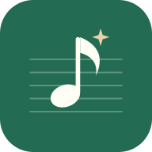
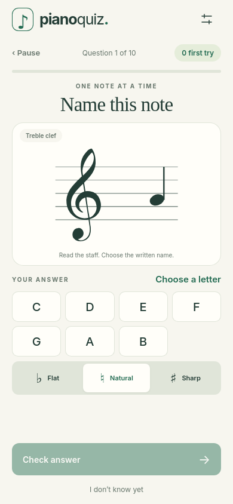
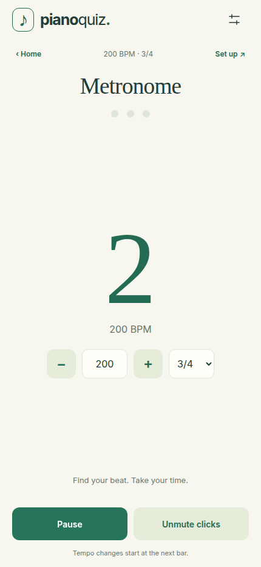
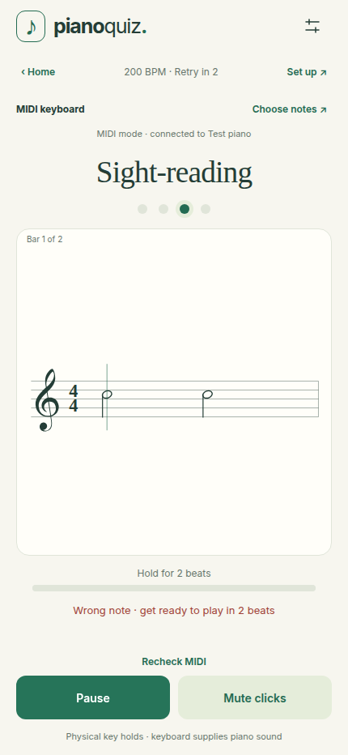

<p align="center"></p>

<h1 align="center">Piano Quiz</h1>
<p align="center">Read a note. Find your beat. Make it second nature.</p>
<p align="center"><a href="https://piano-quiz.pages.dev/"><strong>Open Piano Quiz →</strong></a></p>

A little piano practice for your phone or tablet. Learn to recognise notes and
chords on the staff, find a steady beat, and practise short melodies with your
MIDI keyboard.

<p align="center"></p>

## Pick your practice

| Activity | What you practise | Input |
| --- | --- | --- |
| **Quiz** | Recognise notes and chords | Tap answers or MIDI |
| **Metronome** | A steady beat at your own tempo | Listen and follow along |
| **Rhythm** | When to press, hold, and release | Touch pad or any MIDI key |
| **Sight-reading** | Read pitches and note lengths together | MIDI keyboard |

## Start in a minute

1. [Open the app](https://piano-quiz.pages.dev/).
2. Keep **Quiz** selected and tap **Choose notes** to pick your clef, notes, octaves, and chord types.
3. Choose **Tap names** or **MIDI keyboard**, then tap **Let’s practise**.

With tap answers, choose the letter and accidental, then **Check answer**. For
chords, choose the root and chord type too. With MIDI, play the exact displayed
note. Chords are checked after you release the keys.

Green means correct. Red gives you another chance to try the same question.
MIDI notes react on key press: mistakes never block your next attempt.
**I don’t know yet** or **Skip note** shows the answer and moves on. Your score
counts your first attempt, so retries help you learn without adding extra misses.

## Practise what you need

| Choose | Make it yours |
| --- | --- |
| Notes, chords, or both | All 11 supported chord types |
| Treble, bass, or mixed clefs | Separate progress for each clef |
| Naturals, sharps, and flats | Only the written names you select |
| Different octaves | Higher notes, lower notes, and ledger lines |
| Short sessions | 10 or 20 questions, with pause and resume |
| Your favourite look | 14 themes, plus your device preference |

Want higher C? In **Choose notes → Staff range**, select **C5–B5** under Treble.
C5 sits in the third space. Keep C4–B4 selected if you want to practise both.

Choosing C♯ does not add D♭ to the quiz. Tap answers check the written spelling;
a MIDI keyboard checks the sounding pitch and octave.

## Find your rhythm

Choose **Metronome** from the activity selector on Home. Set a tempo from
40–200 BPM and choose 3/4 or 4/4. The first beat is accented, and the beat lights
help you follow along. Pause, resume, or mute the clicks whenever you need.
Tempo changes during playback take effect at the next bar.

### Rhythm exercises

Choose **Rhythm** to practise when to press, how long to hold, and when to rest.
Choose **Touch pad** or **MIDI keyboard** on Home before starting.
Use the pad or any MIDI key. A half note lasts two
beats; letting go after one beat counts as too short. The music keeps moving
through mistakes, and the results show beat timing and note lengths separately.

Choose a **Rhythm level** in **Set up**:

| Level | What it adds |
| --- | --- |
| **Starter** | Quarter and half notes |
| **Steady** | Longer holds and rests |
| **Moving** | Pairs of eighth notes |
| **Challenge** | Dotted notes, offbeats, and more rests |

Bars use different patterns before repeating, with repeats spread apart. The
same level choices apply to Sight-reading. Naturals, sharps, and flats control
which pitches you practise; they do not limit the rhythm patterns. Selecting
more notes also gives melodies more variety.
The hold meter shows when to release; green appears after a correct release.
A valid release briefly keeps the meter completely full before the next note.
Beginner timing is more forgiving, and a full-bar count-in between bars gives
you time to read ahead. In **Set up**, choose **Strict** timing or **Keep playing**
when you want a challenge, and adjust the tempo and exercise length.
Pausing restarts the interrupted
bar with a count-in. Rhythm results save separately from your quiz history.

### Sight-reading

Choose **Sight-reading** and use your MIDI keyboard to play short melodies.
The exercise uses the notes, octaves, and clefs you chose in **Choose notes**.
Your keyboard supplies the piano sound; the app supplies the beat.

Play each note on the metronome beat and hold it for its full value. A wrong
pitch, missed beat, short or long hold, or rest mistake resets the whole bar.
The metronome keeps going while **“Wrong note · get ready to play in … beats”**
counts you back in on a downbeat. Completed bars stay completed, and the results
show how many bar retries you needed.

Use **Choose notes** directly on Home or above the score to change your melody
notes. **Save practice** stays visible while you browse the choices.

One bar fills the score area on every screen. The next bar appears during its
count-in, giving you time to read before playing. You can pause and retry the interrupted
bar with a fresh count-in. Sight-reading also uses the **Between bars**
setting: a count-in by default, or no break when you choose **Keep playing**.
Recent results save on this device and appear on Home.

### Review a session

Sight-reading shows how many bars you cleared without a retry, how many times
you retried, and how long you practised. Earlier mistakes stay in the report
after a successful replay. Rhythm also shows your timing and hold scores.

Tap a bar or **Session details** to see the mistake breakdown and how often
matched presses were early, near the beat, or late. The report suggests what
to practise next. Open **Last session** on Home to review it again.

Choose **Practise hardest bar** to replay the bar with the most retries
(or the most mistakes in Rhythm). You can also choose any bar in the report.
Play at the original tempo or start about 20% slower. The drill keeps the
original notes and rests and leaves the full-session result saved.

**History** on Home keeps the latest 60 full Rhythm and Sight-reading sessions
on this device. Each trend compares matching practice setups, including tempo,
level, timing correction and the note range when relevant. Tap a point or
session to reopen the report and practise a bar again.

For MIDI timing, choose **Calibrate MIDI timing** in exercise setup or App
settings. Listen to four clicks, then play one key on each of the next twelve
clicks. You can apply the suggested correction or try again. It estimates the
combined timing of your playing, keyboard and audio setup.

<details>
<summary><strong>Take a look at the new practice modes</strong></summary>

<p align="center"> </p>

</details>

## Connect your keyboard

Choose **MIDI keyboard** and start practice, then allow MIDI access when asked.
You can select an input in **App settings**. If unplugging and reconnecting stops
working, tap **Recheck MIDI**.

Notes answer immediately on key press. For chords, hold the displayed tones together, then release them. The app reads
physical key releases, so the sustain pedal does not keep an answer open.
Use your keyboard’s own sound, or enable **Piano after answering**.

MIDI needs a browser with Web MIDI support, such as Chrome on Android or a
compatible desktop browser. Safari on iPhone/iPad and Firefox on Android do not
provide Web MIDI; the quiz, metronome, and touch rhythm practice still work there.
[Check browser support](https://developer.mozilla.org/en-US/docs/Web/API/Navigator/requestMIDIAccess#browser_compatibility).

## Make it a small daily habit

Finish one round for your daily goal. Missed notes come back for more practice,
and the app spaces out reviews as you learn. There is no penalty for taking a day off.

Your preferences and unfinished round save in this browser. No account,
microphone, subscription, or tracking is needed. Progress stays on your device;
it does not sync between browsers.

### Install and practise offline

Use **Install app** or **Add to Home Screen** in your browser. App settings will
tell you when offline practice is ready. Reopen the app and choose **Update app**
when an update is offered; your learning history stays saved.

### Keep practising without interruptions

The screen stays awake while a quiz, metronome or exercise is open. You can turn
this off under **App settings → Keep screen awake**. Switching apps or returning
Home releases the screen lock; returning to practice requests it again.

On your tablet, tap the **four arrows next to App settings** to enter or leave
fullscreen. The same control is under **App settings → Screen**. Installed apps
also request fullscreen. Your browser and device control whether system bars
can be hidden; unavailable or blocked features are explained in settings.

## For developers

Requires Node.js 24 or newer.

```sh
npm ci
npm run build
npm test
npm run dev
```

Open **http://127.0.0.1:8421/**. Rebuild after source changes.

[Development guide](docs/DEVELOPMENT.md) · [Tests and device limits](docs/VERIFICATION.md) · [Cloudflare deployment](DEPLOY.md)

## Credits

Adapted from the notation and music theory in the original `random_piano` app.
Piano recordings: **Salamander Grand Piano V3**, Alexander Holm, CC BY 3.0.
[Sample credits](audio/CREDITS.txt). The treble-clef outline is public domain;
its attribution is preserved in the source.
